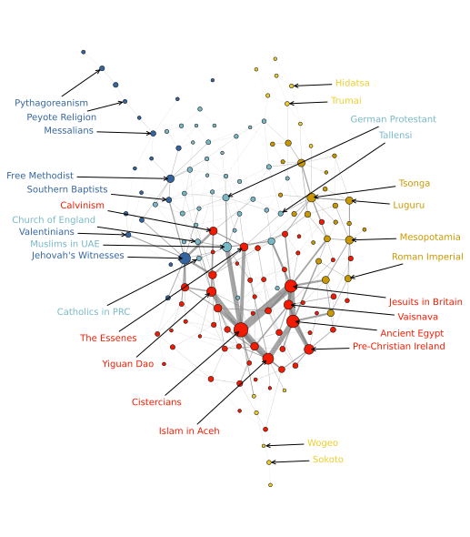

## Overview



Code for "Inferring Cultural Landscapes with the Inverse Ising Model" (https://www.mdpi.com/1099-4300/25/2/264) accepted in *Entropy* on the 25th of January 2023.
We would be very grateful for comments, questions, and thoughts. Parts of the analysis are easily reproducible, but a full reproduction is currently not possible since the raw dataset exceeds GitHub size limits. If a full reproduction is desired, please contact the authors. 

```
@article{poulsen2023inferring,
  title={Inferring Cultural Landscapes with the Inverse Ising Model},
  author={Poulsen, Victor M{\o}ller and DeDeo, Simon},
  journal={Entropy},
  volume={25},
  number={2},
  pages={264},
  year={2023},
  publisher={MDPI}
}
```

## 2026 Claude/Codex Analysis

In November 2026 the code and methods of the paper were re-examined by Claude (Anthropic), with an independent review by Codex (OpenAI). This repository now holds the revised code; the code as published is in the git history (commit `23dce37` and earlier), and `mpf --legacy` reproduces the published fit. In brief:

* **The published results reproduce**: the parameter file to 2e-6, and all six tables byte for byte.
* **Partial-MPF, the paper's treatment of missing answers, can be improved** and the "slight tension" noted by Section 2.3.5 can be resolved. Two corrected versions are provided (`--marginal`, `--frozen`). At the paper's sample sizes the three agree closely, so the paper's simulation results and DRH parameters are not materially affected.
* **Blanks in the DRH are related to other answers** (e.g. entries with a blank report scriptures far less often), so the `--frozen` version, which allows for this, is the one to use for these data.
* **Two- and three-flip neighbourhoods (N₂, N₃) are implemented again.** N₂ lowers the KL divergence by 8% and 20% in the two strongly coupled simulation regimes, contrary to the paper's remark that it "does not improve significantly"; it makes no difference in the weakly coupled regimes, where the DRH sits.
* **The DRH landscape is stable, its division into three groups is not.** Refits with `--frozen` at N₁, N₂ and N₃ keep the 15 strongest couplings, 130–136 of the 150 most probable configurations, and the local landscapes of the Free Methodist Church and the Roman Imperial Cult. The clustering behind Figure 4A and Tables 5, A2–A4 changes as much when 149 or 151 configurations are clustered instead of 150 as it does under a refit.
* **Software**: defects fixed (none changes a number in the paper that could be checked), fits 50–150 times faster, a test suite, and one command to regenerate every figure and table from a parameter file.

The full account, including the errors found, which of them reach the paper, the evidence for each statement, and the limits of this analysis, is in [CLAUDE_IMPROVEMENTS_SUMMARY.md](CLAUDE_IMPROVEMENTS_SUMMARY.md). The regenerated analyses are in [regenerated/](regenerated/).

## Components
### ```/data```
* ```data/mdl_experiments```: processed DRH data (post-MPF).
* ```data/clean```: processed DRH data (pre-MPF).
* ```data/reference```: reference files (i.e. ensuring links between questions and cultures). 
* ```data/preprocessing```: files created from ```/preprocessing``` (used in ```/analysis```)
* ```data/analysis```: files created from ```/analysis```. 

Raw data from the DRH (i.e. pre-curation) is not provided given size limits. 
This might be available upon request. Everything after subset curation is provided.

### ```/fig```
Figures for "Inferring Cultural Landscapes with the Inverse Ising Model" (```5. Results: The Database of Religious History```)

### ```/tables```
Tables for "Inferring Cultural Landscapes with the Inverse Ising Model". (```5. Results: The Database of Religious History```)

### ```/preprocessing```
Preprocessing and data curation for the DRH (prior to ```/analysis```). Relies on ```Python``` (and optionally ```Julia```).
Some of the preprocessing (e.g. ```/preprocessing/preprocessing.py``` and ```/preprocessing/curation.py```) happens prior to the inference step, while the rest happens after. The raw data is not included here since it exceeds GitHub size limits, but the analysis can be reproduced from the inference step. For more, see the ```README``` in ```/preprocessing```.

### ```/analysis```
Code to reproduce the analysis, figures (```/fig```), and tables (```/tables```) related to the ```DRH``` case study. 
Where natural, one script reproduces a particular figure or table (e.g. ```/analysis/fig_3_parameters.py``` creates the two figures that make up *Figure 3* in the article). Some interdependencies between documents exist, e.g. ```/analysis/fig_4_landscape.py``` relies on ```/analysis/prep_fig_4_landscape.py``` and ```/analysis/fig_A1_dendrogram.py```. For more, see the ```README``` in ```/analysis```.

### ```/MPF_CMU``` 
MPF_CMU contains the optimized C code to implement all of the extensions and modifications to MPF described in our paper. The code was revised in 2026 (see *2026 Claude/Codex Analysis* above, and ```CLAUDE_IMPROVEMENTS_SUMMARY.md```); the published fits are reproduced with the ```--legacy``` option. ```MPF_CMU/tests``` holds the test suite (```make test```) and ```MPF_CMU/validation``` the experiments behind the 2026 analysis. Many of the original simulations were carried out on the Bridges2 Pittsburgh Supercomputing Center system, and for speed the code uses multiple cores with OpenMP. You may need to adjust the Makefile to compile on your local system. Note that the compiler that ships with Apple-silicon Macs does not support OpenMP; you will need to install a (non-Apple) clang compiler or gcc. For details, see ```MPF_CMU```.

### ```/regenerated```
The whole DRH analysis (data products, figures, tables) regenerated by ```analysis/regenerate.py``` from the published parameters and from the 2026 refits, with comparisons. The published outputs in ```/data```, ```/fig``` and ```/tables``` are unchanged.

## Getting Started (DRH analysis)

Environments tested on ubuntu version 22.04 LTS. 

### Requirements 

Working installation of ```Python``` (tested with v3.10.6). ```Julia``` (tested with v1.8.5) is optional: ```/preprocessing/expand_data.py``` does the same job as ```/preprocessing/expand_data.jl```.

### Installation

1. Clone the repo (if not already done). Here shown for ```ssh``` but ```https``` also fine:
    ```sh
    git clone git@github.com:victor-m-p/humanities-glass.git
    ```

2. Install the ```Python``` environment (```glassenv```):
    ```sh
    bash venv_create.sh
    bash venv_add.sh
    ```

3. (Optional) Install the ```Julia``` packages used in ```/preprocessing/expand_data.jl``` with the Julia REPL.

4. To regenerate the whole analysis from a parameter file into a new folder (the published outputs are not touched):
    ```sh
    python analysis/regenerate.py data/mdl_experiments/matrix_questions_20_maxna_5_nrows_455_entries_407.txt.mpf_params.dat regenerated/NAME
    ```

<!-- LICENSE -->
## License
Distributed under the MIT License. See `LICENSE.md` for more information.

## Contact
Simon DeDeo (for ```/MPF_CMU``` questions):
* Twitter: [@LaboratoryMinds](https://twitter.com/LaboratoryMinds)
* Github: [@simon-dedeo](https://github.com/simon-dedeo)
* Mail: sdedeo@andrew.cmu.edu

Victor Poulsen (for other questions): 
* Twitter: [@vic_moeller](https://twitter.com/vic_moeller) 
* GitHub: [@victor-m-p](https://github.com/victor-m-p)
* Mail: victormoeller@gmail.com

<!-- ACKNOWLEDGMENTS -->
## Acknowledgments
We are particularly grateful to the creaters of ```conIII``` and the maintainers and creators of the ```Database of Religious History (DRH)```.

* [ConIII](https://github.com/eltrompetero/coniii)
* [Database of Religious History (DRH)](https://religiondatabase.org/landing/)

## FUNDING
This work used the Extreme Science and Engineering Discovery Environment (XSEDE), which is supported by National Science Foundation grant number ACI-1548562. Specifically, it used the Bridges-2 system, which is supported by NSF award number ACI-1928147, at the Pittsburgh Supercomputing Center (PSC), under grant HUM220003. This work was supported in part by the Survival and Flourishing Fund.
